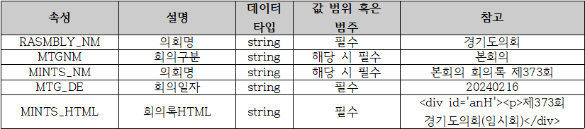
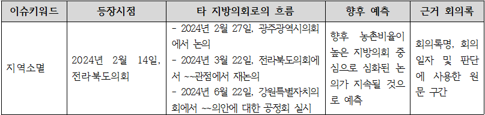

# 2026 DATA·AI 분석 경진대회 — 문제 정리

> **문제명:** 광역 지방의회 회의록 기반 지방정책 이슈 트랜드 분석 및 흐름 예측  
> **주관:** 국회도서관  
> **참가신청 기간(페이지 표기):** 2026-09-15 ~ 2026-11-06

## 1. 한눈에 보기

광역 지방의회 회의록을 분석하여 지역별 **주요 정책 이슈**를 찾고, 이슈가 제공 데이터 안에서 처음 관측된 시점부터 다른 지방의회에서의 후속 논의까지 추적한 뒤, 앞으로의 확산 가능성을 근거와 함께 제시하는 AI 기반 서비스 모델을 개발하는 과제입니다.

## 2. 배경과 목적

- 지역 현안에 대응하려고 발의된 선도 정책이 다른 지방자치단체로 퍼지는 사례가 존재합니다.
- 다수 지방의회에서 생성된 방대한 회의록 때문에 정책·이슈의 전파 경로를 파악하기 어렵습니다.
- 국회도서관이 축적한 지방의회 회의록 빅데이터를 AI로 분석해 지역별 정책 태동과 이슈 트렌드를 예측·규명합니다.
- 이를 통해 국민의 알 권리를 보장하고 국회의원의 의정활동을 지원하는 것이 목적입니다.

## 3. 해결해야 할 문제

광역 지방의회 회의록 데이터를 활용해 다음을 수행하는 AI 기반 분석·예측 서비스 모델을 만듭니다.

1. 지역 이슈 트렌드 분석
2. 지방의회 간 정책 전파·확산 흐름 추정
3. 향후 확산 가능성 예측

### 해석 시 반드시 지킬 기준

| 항목 | 기준 |
|---|---|
| **최초 등장** | 전체 현실에서 최초라는 뜻이 아니라, **제공된 데이터 범위에서 처음 관측된 시점**을 뜻함 |
| **전파·확산 흐름** | 회의록의 시간적 선후관계와 명시적 상호 참조를 근거로 **추정**함 |
| **인과관계 판단** | 근거 없이 특정 지방의회가 다른 지방의회에 영향을 줬다고 단정하면 안 됨 |

## 4. 기대 결과물

이슈별로 서술형 분석 결과를 제공해야 합니다.

| 분석 항목 | 제시 내용 |
|---|---|
| 핵심 이슈 | 주요 이슈 키워드 식별 |
| 최초 관측 | 제공 데이터 내 최초 관측 시점 |
| 후속 논의 | 다른 광역 지방의회에서 나타난 이후 논의 흐름 |
| 향후 전망 | 이슈의 향후 확산 가능성 및 판단 근거 |
| 근거 제시 | 회의록명, 회의일자, 해당 원문 구간 |

## 5. 평가 기준

1. 핵심 이슈 도출의 적절성
2. 이슈 최초 등장 시점 및 타 지방의회 전파 경로 추적의 정밀도
3. 핵심 이슈 파급 흐름 예측의 논리적 타당성

---

# 데이터 정리

## 6. 데이터 기본 정보

| 항목 | 내용 |
|---|---|
| 유형 | 텍스트 |
| 포맷 | JSON |
| 출처 | 각 광역 지방의회 |
| 이용 제한 | 경진대회 이외의 목적으로 사용할 수 없음 |
| 다운로드 경로 | [국회도서관 국가학술정보 클라우드](https://losi-open.nanet.go.kr/main.do) → 데이터셋 → `2026 DATA·AI 분석 경진대회` → `광역 지방의회 회의록 데이터셋` |

## 7. JSON 레코드 예시 및 필드 의미

페이지의 샘플은 회의록 레코드 배열(JSON)입니다.

| 필드 | 예시 | 의미 |
|---|---|---|
| `RASMBLY_NM` | `경기도의회` | 지방의회명 |
| `MTGNM` | `본회의`, `보건복지위원회` | 회의 또는 위원회명 |
| `MINTS_NM` | `본회의 회의록 제373회` | 회의록명 |
| `MTG_DE` | `20240216` | 회의일자 (`YYYYMMDD`) |
| `MINTS_HTML` | HTML 문자열 | 회의록 원문 |



### 데이터 샘플

```json
[
  {
    "RASMBLY_NM": "경기도의회",
    "MTGNM": "본회의",
    "MINTS_NM": "본회의 회의록 제373회",
    "MTG_DE": "20240216",
    "MINTS_HTML": "<div id='anH'><p>제373회 경기도의회(임시회)</div>"
  },
  {
    "RASMBLY_NM": "경기도의회",
    "MTGNM": "보건복지위원회",
    "MINTS_NM": "보건복지위원회 회의록 제373회(1차)",
    "MTG_DE": "20240216",
    "MINTS_HTML": "<div id='anH'><p>제373회 보건복지위원회 1차</div>"
  }
]
```

---

# 제출물 체크리스트

## 8. 반드시 제출할 것

- [ ] 회의록을 분석하는 전체 모델 소스 코드
- [ ] 데이터 전처리 코드
- [ ] 실행 방법을 설명한 문서
- [ ] 실행환경과 라이브러리 버전 정보
- [ ] 예시 입력 및 예시 출력
- [ ] 이슈별 서술형 분석 결과
- [ ] 각 분석 결과의 근거: 회의록명·회의일자·원문 구간

## 9. 분석 결과에 포함할 내용

각 이슈에 대해 다음 흐름으로 제시합니다.

```text
이슈 키워드
→ 제공 데이터 내 최초 관측 시점 및 근거
→ 타 지방의회의 후속 논의 시점·흐름·근거
→ 향후 확산 가능성 및 논리적 근거
```

## 10. 외부 모델·API 사용 규칙

| 항목 | 규칙 |
|---|---|
| 사전학습 모델·외부 API·외부 자료 사용 | 명칭, 버전, 용도, 적용 범위를 기술문서에 명시해야 함 |
| 상용 LLM API (OpenAI, Anthropic 등) | **제공 데이터를 외부로 전송하는 사용은 허용되지 않음** |
| 자체 실행형 오픈 모델 | 제공 데이터가 외부로 전송되지 않는 경우 활용 가능 |

## 11. 예측 시점 규칙

- 향후 예측에는 주최 측이 정한 **분석 기준일 이전의 정보만** 사용해야 합니다.
- 분석 기준일 이후의 정보는 사용하면 안 됩니다.



> 위 이미지와 예시는 제출 형식 설명용이며, 실제 분석 결과나 정답을 뜻하지 않습니다.

---

## 12. 구현·검수 핵심 포인트

### 구현 시

- `MINTS_HTML`에서 텍스트와 인용 가능한 원문 구간을 안정적으로 추출합니다.
- 날짜(`MTG_DE`)와 지방의회(`RASMBLY_NM`)를 기준으로 이슈 언급을 시간순으로 정렬합니다.
- 이슈 간 단순 동시성·시간 선후관계와, 원문에서 확인되는 명시적 상호 참조를 구분합니다.
- 최초 등장은 외부 사실이 아니라 **제공 데이터 안에서의 최초 관측**으로 표기합니다.

### 제출 전

- 모든 이슈 분석 결과에 회의록명, 회의일자, 원문 구간이 있는지 확인합니다.
- 정책 전파를 인과관계로 단정한 표현이 없는지 검토합니다.
- 외부 모델/API 사용 내역과 버전을 기술문서에 빠짐없이 기록합니다.
- 분석 기준일 이후 정보가 입력·참조·학습·예측 근거에 섞이지 않았는지 확인합니다.

---

## 출처

- 대회 문제 페이지: https://aida.kisti.re.kr/competition/main/problem/PROB_000000000004600/detail.do
- 데이터 다운로드 안내: https://losi-open.nanet.go.kr/main.do

*정리 기준: 대회 문제 페이지 및 해당 페이지의 공개 `문제 설명`·`데이터 설명` 탭. 첨부 파일 `2026_참가신청서.hwp`와 실제 전체 데이터는 이 문서 작성 시 별도 열람하지 않았습니다.*
