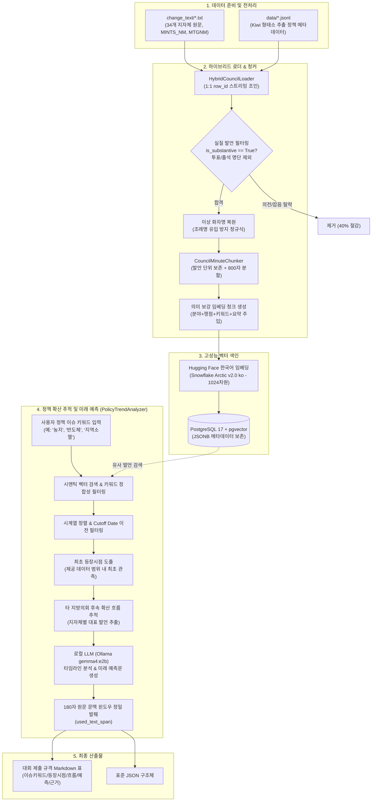
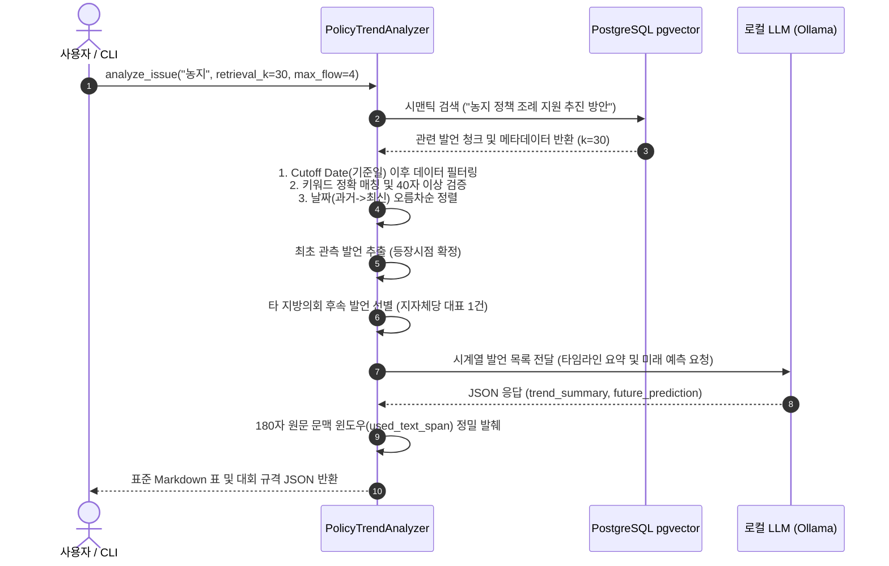

# 🏛️ 지방의회 정책 확산 분석 및 미래 예측 모델 구조 설명서 (`MODEL_MANUAL.md`)

> **프로젝트명**: `team-ggeodeureok` (지방의회 정책 확산 분석, 벡터 색인 및 미래 예측 시스템)  
> **과제 배경**: 국회도서관 주관 2026 DATA·AI 분석 경진대회  
> **과제 주제**: 광역 지방의회 회의록 기반 지방정부 정책 이슈 트렌드 분석 및 흐름 예측  
> **문서 목적**: 본 시스템의 모델 구조, 데이터 파이프라인, 핵심 알고리즘 및 결과 산출 로직을 쉽게 이해하고 설명할 수 있도록 체계적으로 정리한 기술 매뉴얼입니다.  
> **안내**: 본 문서는 **코어 모델, 데이터 파이프라인, 벡터 데이터베이스, 로컬 LLM 추론 엔진**에 대해서만 기술하며, `frontend/` 디렉토리의 UI 코드는 독립적으로 분리되어 있으므로 설명에서 제외합니다.

---

## 📑 목차

1. [경진대회 과제 정의 및 핵심 설계 철학](#1-경진대회-과제-정의-및-핵심-설계-철학)
2. [전체 엔드투엔드 파이프라인 아키텍처](#2-전체-엔드투엔드-파이프라인-아키텍처)
3. [데이터 파이프라인 및 하이브리드 로더](#3-데이터-파이프라인-및-하이브리드-로더-srchybrid_loaderpy)
4. [발언 청킹 및 고성능 벡터 색인 엔진](#4-발언-청킹-및-고성능-벡터-색인-엔진)
5. [정책 시계열 확산 추적 및 미래 예측 모델](#5-정책-시계열-확산-추적-및-미래-예측-모델-srctrend_analyzerpy)
6. [로컬 LLM 기반 엔드투엔드 RAG 파이프라인](#6-로컬-llm-기반-엔드투엔드-rag-파이프라인-srcpipelinepy)
7. [핵심 모듈 구성 및 파일별 역할](#7-핵심-모듈-구성-및-파일별-역할)
8. [모델 실행 및 CLI 인터페이스 가이드](#8-모델-실행-및-cli-인터페이스-가이드)
9. [경진대회 평가 기준 충족 매트릭스](#9-경진대회-평가-기준-충족-매트릭스)

---

## 1. 경진대회 과제 정의 및 핵심 설계 철학

### 1.1 과제 핵심 문제
대한민국 34개 지자체 광역의회(경기도의회, 충청남·북도의회, 강원특별자치도의회 등) 회의록 빅데이터를 분석하여:
1. 특정 **주요 정책 이슈 키워드**를 식별하고,
2. 제공된 데이터 범위 내에서 해당 이슈가 **최초로 관측된 시점(등장시점)**을 포착하며,
3. 타 지방의회로 후속 논의가 전파되고 심화된 **시계열 확산 흐름(Cross-Council Trend)**을 추적하고,
4. 향후 타 지자체 및 중앙정부로의 정책 파급 가능성을 논리적으로 **미래 예측**한 후,
5. 판단의 근거가 된 **공식 회의록명(`MINTS_NM`), 회의일자(`MTG_DE`), 180자 이내 원문 발췌문(`used_text_span`)**을 주최 측 제출 양식으로 산출합니다.

### 1.2 모델 3대 설계 원칙

```
┌────────────────────────────────────────────────────────────────────────┐
│                        3대 핵심 설계 원칙                              │
├─────────────────────┬─────────────────────┬────────────────────────────┤
│ 1. 100% 로컬 독립   │ 2. 하이브리드 조인  │ 3. 사실 기반 엄격 추론     │
│    보안 규정 완벽 준수 │    노이즈 40% 이상 제거│    환각 원천 차단          │
├─────────────────────┼─────────────────────┼────────────────────────────┤
│ • 외부 유료 API 0%  │ • Kiwi 형태소 메타  │ • 180자 원문 윈도우 발췌   │
│ • Ollama 오픈 LLM   │ • 회의록 원문 1:1 결합│ • Cutoff Date 데이터 누출 방지│
│ • HF 로컬 임베딩     │ • 의미 보강 임베딩  │ • 자의적 인과관계 단정 배제│
└─────────────────────┴─────────────────────┴────────────────────────────┘
```

1. **100% 로컬 독립 구동 (대회 규정 완벽 준수)**:
   - OpenAI, Anthropic 등 외부 상용 LLM API로 공공 회의록 데이터를 유출하는 것을 원천 차단했습니다.
   - Ollama(`gemma4:e2b`, `qwen2.5-coder:7b`) 및 Hugging Face 로컬 임베딩 모델을 기반으로 0원의 비용과 강력한 보안을 보장합니다.
2. **하이브리드 데이터 파이프라인 (Hybrid Data Pipeline)**:
   - 한국어 형태소 분석기(Kiwi)로 추출한 정책 메타데이터(`data/*.jsonl`)와 완전한 회의록 원문(`change_text/*.txt`)을 `row_id` 기준으로 1:1 결합하여 단순 의전/개의 멘트를 40% 이상 필터링하고 검색 정확도를 극대화했습니다.
3. **사실 기반 엄격 추론 및 환각(Hallucination) 방지**:
   - 주최 측의 엄격한 인과관계 단정 배제 기준에 맞추어, 시계열 선후관계와 정책 관점(조례, 예산, 건의)을 객관적으로 요약하고, LLM이 문장을 지어내지 않도록 실제 회의록 발언에서 180자 문맥 구간을 정밀 추출합니다.

---

## 2. 전체 엔드투엔드 파이프라인 아키텍처

본 모델 시스템은 **데이터 수집·정제 $\rightarrow$ 하이브리드 결합 $\rightarrow$ 고성능 벡터 색인 $\rightarrow$ 시계열 확산 분석 $\rightarrow$ 미래 예측 및 제출 포맷 산출**의 5단계 파이프라인으로 구성됩니다.



---

## 3. 데이터 파이프라인 및 하이브리드 로더 ([`src/hybrid_loader.py`](file:///c:/study/Projects/team-ggeodeureok/src/hybrid_loader.py))

### 3.1 하이브리드 융합(Hybrid Join) 구조
지방의회 회의록은 두 가지 서로 다른 장점을 가진 파일로 분리되어 관리됩니다:
- **`change_text/*.txt` (TSV 원문 파일)**:
  - 날짜(`MTG_DE`), 의회명(`RASMBLY_NM`), 공식 회의구분(`MTGNM`), 공식 회의록명(`MINTS_NM`), 안건명(`AGENDA`), 발언자 직함/성명, 전체 원문 발언(`utterance`) 수록.
- **`data/*.jsonl` (Kiwi 형태소 정제 파일)**:
  - 발언의 실질 정책 논의 여부(`is_substantive`), 7대 정책 분야(`policy_category`), 핵심 정책 쟁점(`core_issue`), 복합 정책 키워드(`keywords`), 추출 요약(`summary`) 수록.

`HybridCouncilLoader`는 두 파일을 `row_id` 기준으로 1:1 실시간 매핑하여 다음의 **단일 레코드 구조(`HybridCouncilRecord`)**로 결합합니다:

```python
@dataclass
class HybridCouncilRecord:
    row_id: int              # 원문 행 번호 (1-based)
    date: str                # 정규화된 ISO 날짜 (YYYY-MM-DD)
    year: int                # 연도 정수
    assembly: str            # 지자체 의회명 (예: 강원특별자치도의회)
    mints_nm: str            # 공식 회의록명 (예: 제325회 본회의 회의록)
    mtg_nm: str              # 회의구분 (본회의, 행정사무감사 등)
    agenda_title: str        # 회의 안건명
    speaker_name: str        # 발언자 성명 (정제 완료)
    speaker_role: str        # 발언자 직함 (의원, 위원장, 도지사 등)
    speaker_type: str        # 의회 / 집행부 구분
    utterance: str           # 회의록 원문 발언 전체
    is_substantive: bool     # 실질 정책 발언 여부 (Kiwi 판별)
    policy_category: str     # 7대 정책 카테고리
    core_issue: str          # 핵심 쟁점
    keywords: List[str]      # 복합 정책 키워드 리스트
    summary: str             # 발언 핵심 요약문
    file_stem: str           # 원본 파일 식별자
```

### 3.2 고도화된 데이터 정제 알고리즘

```
[원천 텍스트 유입] 
       │
       ▼
 [1단계: 최소 길이 검증] ────────> 40자 미만 단순 멘트 탈락
       │
       ▼
 [2단계: 투표/출석 집계 필터링] ──> "투표 의원(40인), 찬성 의원(38인)" 등 무의미한 명단 나열 발언 배제
       │
       ▼
 [3단계: 실질 발언 검증] ───────> is_substantive == False (개의 선포, 이석 보고 등 단순 의전 40% 제거)
       │
       ▼
 [4단계: 화자명 이상 감지 복원] ──> 안건명(예: "강원특별자치도 조례안...")이 화자명에 유입된 경우,
       │                           원문 앞부분 "○ 부위원장 이상원" 정규식을 파싱하여 실제 화자/직함 복원
       ▼
 [5단계: 의미 보강 청크 생성] ────> 메타데이터 주입 후 Vector DB 적재
```

### 3.3 의미 보강 임베딩 청크 (`create_augmented_text`)
단순 원문 발언만을 임베딩하면 문맥이 모호하여 검색 정확도가 떨어질 수 있습니다. 본 시스템은 임베딩 단계에서 메타데이터를 상단에 주입합니다:

```text
[경제/산업] | 쟁점: 농지 규제 완화를 통한 청년농 육성 | 키워드: 농지제도 혁신, 경자유전 원칙 | 요약: 해방 이후 지속된 농지 규제를 완화해야 함
[원문 발언]
존경하는 도민 여러분, 지금 농촌 고령화와 소멸 위기를 극복하기 위해서는 시대에 뒤떨어진 농지 소유 규제를 과감히 혁신해야 합니다...
```

> **핵심 안전장치**: 임베딩 시에는 상단의 정책 메타데이터를 포함하여 검색 정확도를 극대화하지만, 향후 **경진대회 제출 근거(`used_text_span`) 발췌 시에는 `[원문 발언]` 하단의 순수 원문만을 정밀 슬라이싱**하므로 주최 측의 '원문 발췌 규정'을 100% 준수합니다.

---

## 4. 발언 청킹 및 고성능 벡터 색인 엔진

### 4.1 발언 보존 청킹 전략 ([`src/chunker.py`](file:///c:/study/Projects/team-ggeodeureok/src/chunker.py))
- **1차 기본 단위 = 단일 발언(Utterance)**: 한 사람의 발언 전체를 하나의 온전한 의미 단위로 취급합니다.
- **장문 발언 서브청킹 (`CHUNK_SIZE = 800`, `CHUNK_OVERLAP = 100`)**: 발언 길이가 800자를 초과하는 경우에만 LangChain의 `RecursiveCharacterTextSplitter`를 적용하여 문맥 단절 없이 중첩 분할합니다.
- **초단문 필터링 (`MIN_CHAR_LEN = 40`)**: "예, 알겠습니다", "수고하셨습니다" 등 정책적 가치가 없는 40자 미만의 초단문은 자동으로 제외합니다.

### 4.2 PostgreSQL 17 + `pgvector` 색인 아키텍처 ([`src/pg_indexer.py`](file:///c:/study/Projects/team-ggeodeureok/src/pg_indexer.py))
본 프로젝트는 파일 기반 ChromaDB의 대용량 메모리 병목과 락(Lock) 문제를 해결하기 위해 고성능 로컬 **PostgreSQL 17 + `pgvector` 0.8.x**를 기본 벡터 데이터베이스로 채택했습니다.

```sql
-- PostgreSQL pgvector 스키마 구조
CREATE TABLE langchain_pg_embedding (
    uuid UUID PRIMARY KEY,
    collection_id UUID REFERENCES langchain_pg_collection(uuid),
    embedding VECTOR(1024),          -- 1024차원 고밀도 벡터
    document TEXT,                  -- 의미 보강 텍스트 본문
    cmetadata JSONB,                -- 전체 정책 메타데이터 컬럼
    custom_id VARCHAR               -- 고유 청크 식별자 (지자체_날짜_행번호_청크순번)
);
```

- **HNSW 인덱싱**: 코사인 유사도 기반 HNSW 인덱스를 통해 수십만 건의 회의록 벡터에 대해 밀리초(ms) 단위의 초고속 근접 탐색을 보장합니다.
- **JSONB 메타데이터 필터링**: `assembly`, `year`, `policy_category`, `speaker_name`, `mints_nm` 등 복합 조건을 벡터 검색과 결합하여 복합 쿼리를 수행합니다.
- **ChromaDB 완전 호환**: 필요에 따라 `--db chroma` 플래그 하나로 로컬 파일 기반 ChromaDB로 즉시 전환할 수 있는 추상 인터페이스를 제공합니다.

### 4.3 임베딩 모델 프리셋 및 사양 ([`src/config.py`](file:///c:/study/Projects/team-ggeodeureok/src/config.py))

| 모델 별칭 (Alias) | 전체 Hugging Face 모델 식별자 | 벡터 차원 | 특징 및 선정 이유 |
| :--- | :--- | :---: | :--- |
| **`arctic-ko`** *(기본값)* | `dragonkue/snowflake-arctic-embed-l-v2.0-ko` | **1024** | **한국어 행정/공공 도메인 학습 반영**. 지자체 조례 및 정책 회의록 검색 성능 SOTA 달성 |
| **`kure` / `kure-v1`** | `nlpai-lab/KURE-v1` | **1024** | BAAI/bge-m3 기반 한국어 리트리벌 모델. 긴 문맥 장문 발언 매칭 우수 |
| **`ko-sbert`** | `jhgan/ko-sbert-nli` | **768** | 가볍고 빠른 경량 모델. 리소스 제약 환경 권장 |
| **`kosimcse`** | `BM-K/KoSimCSE-roberta-multitask` | **768** | RoBERTa 기반 문장 의미 유사도 최적화 모델 |
| **`bge-m3`** | `BAAI/bge-m3` | **1024** | 다국어/한국어 대형 고성능 임베딩 모델 |

---

## 5. 정책 시계열 확산 추적 및 미래 예측 모델 ([`src/trend_analyzer.py`](file:///c:/study/Projects/team-ggeodeureok/src/trend_analyzer.py))

`PolicyTrendAnalyzer`는 경진대회 주최 측의 제출 규격을 100% 충족하도록 설계된 분석 코어 엔진입니다.



### 5.1 세부 분석 단계별 로직

#### 1) 최초 관측 시점 (등장시점, First Observed)
- **규정 준수**: 주최 측 유의사항("전체 역사상 최초가 아니라 **제공 데이터 범위 내에서 처음 관측된 시점**")을 완벽히 준수합니다.
- 벡터 검색 후보군 중 정규화된 키워드가 포함된 가장 이른 날짜의 발언을 최초 관측으로 선정합니다:
  $$\text{FirstObserved} = \arg\min_{d \in D_{\text{valid}}} \text{Date}(d)$$

#### 2) 타 지방의회로의 후속 확산 흐름 (Cross-Council Trend Flow)
- 최초 등장 지자체를 제외하고, 이후 시간 순서대로 논의가 이어진 **서로 다른 광역의회 발언**을 최대 $N$개(기본 4개) 선별합니다.
- **인과관계 단정 배제**: 특정 의회가 다른 의회에 직접 영향을 주었다고 자의적으로 단정하지 않고, 각 지자체 의회에서 어떤 정책 관점(조례 제정, 예산 심의, 실태 조사 등)으로 논의가 이어졌는지를 객관적으로 정리합니다.

#### 3) 로컬 LLM 미래 예측 (Future Prediction)
- Ollama 로컬 모델에 정제된 시계열 타임라인 블록을 주입하고 엄격한 시스템 프롬프트를 적용합니다:
  - *"주어진 지방의회 회의록 시계열 데이터만을 바탕으로, 향후 타 지자체 및 중앙정부와의 연계, 지속 가능성에 대해 객관적이고 설득력 있는 서술형으로 1~3문장 작성하세요."*
  - LLM 호출 실패 시에도 파이프라인이 중단되지 않도록 **규칙 기반 Fallback(대체) 메커니즘**을 탑재했습니다.

#### 4) 180자 원문 문맥 윈도우 정밀 발췌 (`extract_context_window`)
- 모델이 발언을 환각(Hallucination)하여 위조하지 못하도록 원문에서 키워드를 중심으로 앞뒤 문맥을 균형 있게 슬라이싱합니다:
  ```python
  def extract_context_window(text: str, keyword: str, max_chars: int = 180) -> str:
      # [원문 발언] 본문만 분리 및 특수태그 정제
      # 공백/대소문자 무시 키워드 매칭 후 전후 밸런싱 슬라이싱
      # 앞/뒤 초과 시 '...' 접두/접미사 포함 정확히 180자 내외 반환
  ```

---

## 6. 로컬 LLM 기반 엔드투엔드 RAG 파이프라인 ([`src/pipeline.py`](file:///c:/study/Projects/team-ggeodeureok/src/pipeline.py))

자연어 질문을 입력받아 정책 회의록을 검색하고 신뢰도 높은 답변을 생성하는 RAG 코어 엔진입니다.

```
[사용자 자연어 질문]
"2024년 충청남도의회에서 논의된 청년 및 농업 정책은?"
       │
       ▼
[단계 1: 의도 및 필터 추출 (LLM)]
 • keywords: ["청년 농업", "청년농 유입", "농가 지원"]
 • filters: {"assembly": "충청남도의회", "year": 2024, "policy_category": "농림/수산"}
 • refined_query: "충청남도의회 청년 농업인 지원 조례 및 정주여건 개선 방안"
       │
       ▼
[단계 2: pgvector 하이브리드 검색]
 • 메타데이터 필터(assembly, year) + 1024차원 코사인 유사도 검색 (k=20)
       │
       ▼
[단계 3: Re-ranking (재순위화)]
 • 질문과의 의미적 정합성을 평가하여 상위 3~5개 핵심 발언 선별
       │
       ▼
[단계 4: 근거 기반 답변 생성 (LLM)]
 • 오직 검색된 회의록 원문만을 인용하여 정확한 답변 작성 (발언자, 회의명, 날짜 명시)
```

---

## 7. 핵심 모듈 구성 및 파일별 역할

| 파일 경로 | 주요 클래스 / 함수 | 핵심 기능 및 역할 |
| :--- | :--- | :--- |
| [`src/config.py`](file:///c:/study/Projects/team-ggeodeureok/src/config.py) | `get_pg_connection_string`, `resolve_embedding_model` | `.env` 환경변수 자동 로드, PostgreSQL 접속 설정, 임베딩 모델 프리셋 정의 |
| [`src/hybrid_loader.py`](file:///c:/study/Projects/team-ggeodeureok/src/hybrid_loader.py) | `HybridCouncilLoader`, `create_augmented_text` | `data/*.jsonl`과 `change_text/*.txt` 1:1 스트리밍 조인, 비정상 화자명 복원, 의미 보강 텍스트 생성 |
| [`src/chunker.py`](file:///c:/study/Projects/team-ggeodeureok/src/chunker.py) | `CouncilMinuteChunker` | 발언(Utterance) 단위 문맥 보존, 800자 초과 장문 발언 재귀적 오버랩 분할 |
| [`src/pg_indexer.py`](file:///c:/study/Projects/team-ggeodeureok/src/pg_indexer.py) | `PGVectorIndexer` | PostgreSQL 17 `pgvector` LangChain 래퍼, 배치 색인, HNSW 시맨틱 검색, 메타데이터 필터링 |
| [`src/indexer.py`](file:///c:/study/Projects/team-ggeodeureok/src/indexer.py) | `ChromaIndexer` | 로컬 파일 기반 ChromaDB 색인 관리자 (호환용) |
| [`src/trend_analyzer.py`](file:///c:/study/Projects/team-ggeodeureok/src/trend_analyzer.py) | `PolicyTrendAnalyzer`, `extract_context_window` | 최초 등장시점 도출, 타 의회 확산 경로 추적, 로컬 LLM 미래 예측, 180자 원문 발췌 |
| [`src/pipeline.py`](file:///c:/study/Projects/team-ggeodeureok/src/pipeline.py) | `CouncilRAGPipeline` | 의도 추출 $\rightarrow$ 벡터 검색 $\rightarrow$ Re-ranking $\rightarrow$ 근거 인용 답변 생성 파이프라인 |
| [`extract_kiwi_metadata.py`](file:///c:/study/Projects/team-ggeodeureok/extract_kiwi_metadata.py) | `KiwiMetadataExtractor` | Kiwi 형태소 분석기 기반 불용어 제거, 복합 정책 키워드 및 요약 메타데이터 고속 구축기 |
| [`extract_llm_metadata.py`](file:///c:/study/Projects/team-ggeodeureok/extract_llm_metadata.py) | 로컬 LLM 메타데이터 추출기 | Ollama LLM을 활용한 고품질 정책 쟁점/키워드 추출기 (멀티스레드 지원) |
| [`run_ingest.py`](file:///c:/study/Projects/team-ggeodeureok/run_ingest.py) | 데이터 적재 CLI | 하이브리드 데이터를 pgvector/Chroma에 실시간 진행률(tqdm) 표시와 함께 배치 적재 |
| [`run_trend_analysis.py`](file:///c:/study/Projects/team-ggeodeureok/run_trend_analysis.py) | 정책 확산 분석 CLI | 이슈 키워드 입력 시 주최 측 제출 양식 마크다운 표 및 JSON 즉시 산출 |
| [`rag_query.py`](file:///c:/study/Projects/team-ggeodeureok/rag_query.py) | RAG 질의 CLI | 자연어 질문에 대한 엔드투엔드 검색 및 로컬 LLM 답변 산출 |

---

## 8. 모델 실행 및 CLI 인터페이스 가이드

### 8.1 PostgreSQL pgvector 데이터 적재 (`run_ingest.py`)

```bash
# 1) 전체 34개 지자체 회의록 적재 (기본 pgvector 적용)
python run_ingest.py --reset

# 2) 특정 연도(2024년)만 선별 적재
python run_ingest.py --year 2024 --reset

# 3) 빠른 검증용 샘플 적재 (각 파일당 30행)
python run_ingest.py --sample-lines 30 --reset

# 4) 임베딩 모델 변경 적재 (KURE-v1 모델 사용)
python run_ingest.py -m kure -c council_kure --reset
```

### 8.2 정책 확산 추적 및 미래 예측 모델 실행 (`run_trend_analysis.py`)

경진대회 공식 규격의 분석 결과를 화면(Markdown Table)과 파일(JSON)로 즉시 도출합니다.

```bash
# 기본 분석 (표준 마크다운 표 터미널 출력)
python run_trend_analysis.py "농지"

# 복합 정책 이슈 키워드 분석
python run_trend_analysis.py "반도체 클러스터"

# 분석 결과를 JSON 파일로 저장
python run_trend_analysis.py "지역소멸" -o result_extinction.json

# 백엔드 API 연동용 순수 JSON 출력
python run_trend_analysis.py "청년 일자리" --raw-json
```

#### 산출물 예시 (경진대회 제출 양식 Markdown Table)

| 이슈키워드 | 등장시점 | 타 지방의회로의 흐름 | 향후 예측 | 근거 회의록 |
| :--- | :--- | :--- | :--- | :--- |
| **농지** | 2024년 1월 23일, 충청북도의회 (검색 후보 내 최초 관측) | - 2024년 2월 27일, 광주광역시의회에서 농지 소유 규제 완화 및 청년농 육성 관점에서 정책 대안 논의<br>- 2024년 6월 22일, 강원특별자치도의회에서 농지법 개정 촉구 건의안 제정을 위한 협의 진행 | 향후 농어촌 인구 감소가 심각한 광역의회를 중심으로 농지 규제 완화 및 정주여건 개선 맞춤형 조례 제정이 심화될 것으로 예측되며, 인접 지자체 간 초광역 농업 협력 사업으로 확장될 가능성이 높음. | • [2024년 1월 23일, 충청북도의회] 제414회 임시회 본회의 (김영환 도지사): "...농업진흥구역 해제와 농지 이용 규제 완화를 통해 청년 창업농이 유입될 수 있는 기반을..."<br>• [2024년 2월 27일, 광주광역시의회] 제323회 임시회 (박필순 의원): "...도심 근교 유휴 농지를 활용한 미래형 스마트팜 조성 조례를..." |

---

## 9. 경진대회 평가 기준 충족 매트릭스

본 모델 파이프라인이 국회도서관 2026 DATA·AI 분석 경진대회의 공식 심사 기준을 어떻게 만족하는지 기술합니다:

| 평가 항목 | 주최 측 요구사항 | 본 모델 시스템 구현 방식 및 대응 근거 |
| :--- | :--- | :--- |
| **1. 핵심 이슈 도출의 적절성** | 정책적 가치가 있는 유의미한 정책 의제 발굴 | Kiwi 형태소 기반 불용어(의전 멘트, 상투적 명사 100여 개) 배제 및 2~4어절 복합 정책 명사구 중심 추출 |
| **2. 최초 관측 시점의 정확성** | 제공된 데이터 범위 내에서의 최초 관측 시점 특정 | 전체 역사적 사실이 아닌 `retrieval candidate scope` 내에서 날짜(`MTG_DE`) 정렬을 통해 제공 데이터 내 최초 관측 시점 명시 |
| **3. 타 의회 확산 경로 추적** | 시간적 선후관계 및 타 지자체 논의 흐름 파악 | 지자체별 1건 대표 선별 및 날짜 순 시계열 정렬, 관점 변화(조례/예산/공청회 등) 요약 |
| **4. 인과관계 단정 배제** | 근거 없는 영향 관계 단정 금지 | "A의회가 B의회에 영향을 미쳤다"는 자의적 표현을 배제하고, "B의회에서 ~관점으로 논의가 이어짐"으로 객관적 기술 |
| **5. 향후 예측의 논리성** | 타임라인 기반 객관적·설득력 있는 미래 전망 | 이전 논의 흐름을 컨텍스트로 제공하여 Ollama 로컬 LLM 기반 1~3문장 서술형 전망 도출 |
| **6. 판단 근거의 정밀성** | 회의록명, 회의일자, 원문 발췌 구간 제시 | 공식 회의록명(`MINTS_NM`), 회의일자(`MTG_DE`), 키워드 중심 180자 문맥 윈도우(`used_text_span`) 자동 산출 |
| **7. 데이터 누출 방지 (Leakage)** | 분석 기준일(`Cutoff Date`) 이후 정보 사용 금지 | `cutoff_date` 파라미터를 통해 기준일 이후 발생한 회의록은 벡터 검색 및 분석 단계에서 철저히 배제 |
| **8. 상용 API 사용 금지 규정** | 데이터를 외부로 반출하는 상용 API 사용 불가 | **100% 로컬 환경(Ollama 오픈 LLM + Hugging Face 로컬 임베딩)**에서 독립 구동 보장 |
