# 🏛️ [의정 이슈 레이더] 프로젝트 발표 스크립트 (10분 완성본)

> **팀명**: 꺼드럭'S  
> **팀원**: 최홍석, 전영주, 허민지, 임경빈, 권준, 김권우  
> **대회/과제**: 2026 DATA·AI 분석 경진대회 (국회도서관 광역 지방의회 회의록 빅데이터 분석)  
> **기반 슬라이드**: `PPT/의정_이슈_레이더_꺼드럭'S.pptx` (총 14장)  
> **총 발표 시간**: **9분 20초 ~ 9분 40초 (10분 이내 완벽 종료 보장 타임라인)**

---

## ⏱️ 10분 이내 발표를 위한 슬라이드별 초 단위 시간 배분표

경진대회 10분 타이머 룰을 준수하기 위해 **총 발표 시간을 9분 25초(565초)로 설계**하여 30초 이상의 안전 버퍼를 확보했습니다.

| 슬라이드 | 슬라이드 주제 | 배분 시간 | 누적 시간 | 핵심 전달 내용 |
|:---:|:---|:---:|:---:|:---|
| **Slide 01** | 표지 및 팀 소개 | **20초** | 00:20 | 팀 정체성 및 시스템 정의 |
| **Slide 02** | 문제 배경 및 5대 최종 목표 | **45초** | 01:05 | 선도 정책 확산 추적의 필요성, 5대 산출물 |
| **Slide 03** | 전체 5단계 아키텍처 | **40초** | 01:45 | 원문 근거와 계산 모델 분리 원칙 |
| **Slide 04** | 데이터 전처리 및 Canonical | **45초** | 02:30 | 205만 행 정제, 고유 chunk_id 무결성 |
| **Slide 05** | 부모 · 자식 청킹 구조 | **50초** | 03:20 | 작은 자식(750자) 검색 + 큰 부모(2,400자) 문맥 복원 |
| **Slide 06** | 임베딩 및 벡터 DB 실측·선정 | **60초** | 04:20 | Arctic nDCG 0.8969 / pgvector 복합필터 148배 향상 |
| **Slide 07** | 검색 · 군집화 파이프라인 | **50초** | 05:10 | Dense+BM25 RRF, BGE 재순위, Union-Find 군집화 |
| **Slide 08** | 정책 논의 정량 예측 | **55초** | 06:05 | Rolling Backtest, F1 0.8814, MAE 7.12건 (29.8% 개선) |
| **Slide 09** | 로컬 LLM 및 AI 에이전트 | **45초** | 06:50 | 100% 로컬 Qwen3:8B, 계산은 통계 모델이 설명은 LLM이 |
| **Slide 10** | 핵심코드 ① 하이브리드 검색 | **35초** | 07:25 | Dense + BM25 가중 결합 RRF 구현체 |
| **Slide 11** | 핵심코드 ② 이슈 군집화 | **35초** | 08:00 | 블록 코사인 유사도 행렬 + Union-Find 병합 |
| **Slide 12** | 핵심코드 ③ 외부 API 보안 | **25초** | 08:25 | 화이트리스트 검증 및 접근 감사 로깅 |
| **Slide 13** | 시각화 웹 대시보드 | **45초** | 09:10 | 전국 지도·타임라인·원문 근거·AI 챗봇 5단계 흐름 |
| **Slide 14** | 맺음말 및 질의응답 전환 | **15초** | 09:25 | 마무리 인사 및 당당한 Q&A 개시 |

---

# 🎙️ 슬라이드별 1:1 발표 스크립트 (구어체 대본)

---

### [Slide 01] 표지 (00:00 ~ 00:20 / 20초)

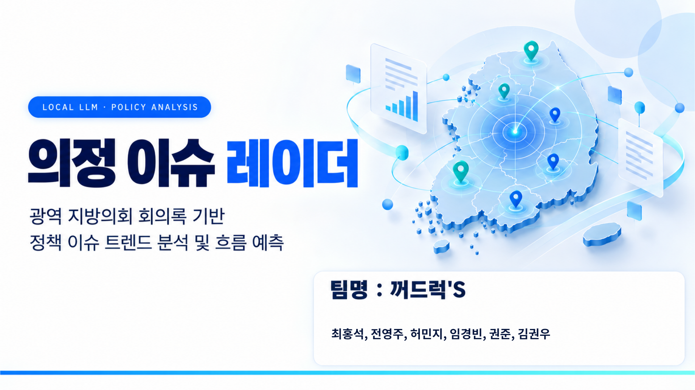

- **핵심 메시지**: 시스템 정체성 명확한 각인
- **구어체 스크립트**:
> "안녕하십니까. 광역 지방의회 회의록 기반 정책 이슈 트렌드 분석 및 흐름 예측 시스템 **'의정 이슈 레이더'**의 발표를 맡은 팀 **꺼드럭'S**의 권준입니다.
> 
> 저희는 전국 지방의회에서 쏟아지는 수백만 건의 회의록 속에서 유의미한 정책이 **어느 지역에서 시작되어 어떻게 전국으로 확산되었으며, 다음 달에는 얼마나 논의될 것인가**를 데이터로 실증 규명했습니다. 지금부터 핵심 내용을 보고드리겠습니다."

---

### [Slide 02] 지방정책 이슈 트렌드 분석 및 흐름 예측 (00:20 ~ 01:05 / 45초)

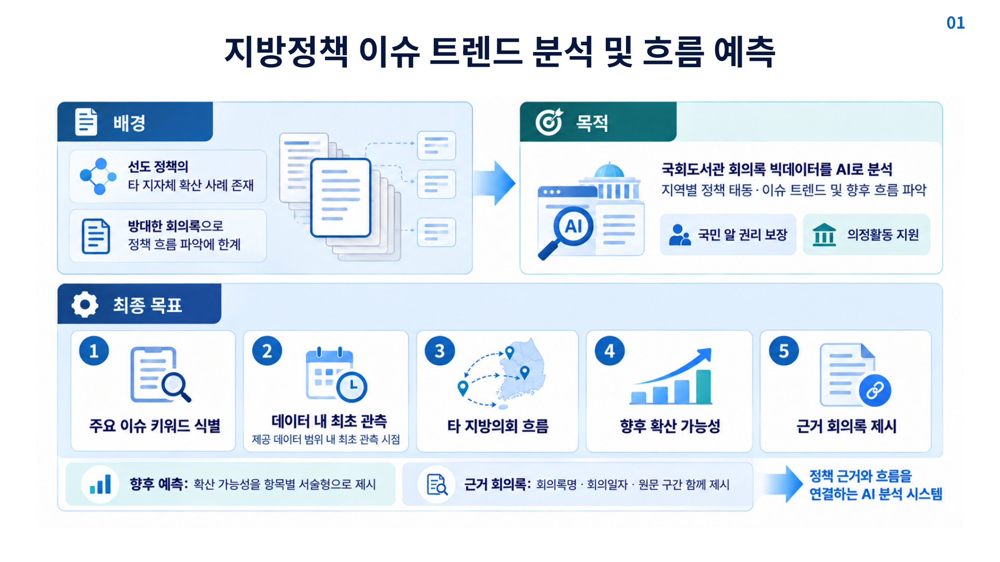

- **핵심 메시지**: 기존 키워드 검색의 한계 극복, 5대 최종 목표 달성
- **구어체 스크립트**:
> "특정 지자체의 선도 정책이 타 지역으로 확산되는 사례는 많지만, 지자체마다 회의록 형식과 조례 명칭이 달라 단순 키워드 검색으로는 정책의 거시적 흐름을 파악할 수 없었습니다.
> 
> 이에 저희는 국회도서관 빅데이터를 AI로 분석하여 화면 하단의 **5가지 목표**를 달성했습니다.  
> 첫째 정책 핵심 키워드 식별, 둘째 데이터 내 최초 관측 시점 도출, 셋째 타 지자체 확산 흐름 추적, 넷째 다음 달 논의 지속 여부 및 언급량 예측, 마지막으로 이 모든 분석의 토대가 되는 회의록 원문 근거 제시입니다.  
> **'정책 근거와 흐름을 잇는 신뢰도 100%의 AI 분석 시스템'**을 만드는 것이 저희의 지향점입니다."

---

### [Slide 03] 의정 이슈 레이더 전체 아키텍처 (01:05 ~ 01:45 / 40초)

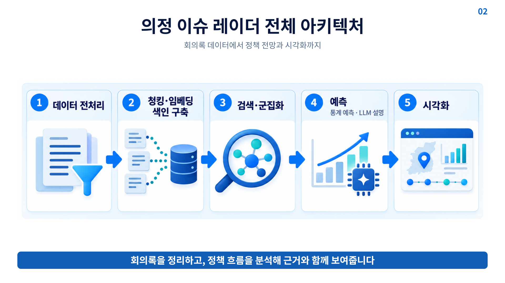

- **핵심 메시지**: 5단계 파이프라인의 완성, 원문 근거와 계산 모델의 엄격한 분리
- **구어체 스크립트**:
> "전체 파이프라인은 5단계로 유기적으로 연결됩니다.
> 
> 1단계 **데이터 전처리**, 2단계 **부모-자식 청킹 및 임베딩 색인**, 3단계 하이브리드 검색과 **그래프 기반 군집화**, 4단계 Rolling Backtest 기반의 **통계 예측 및 로컬 LLM 설명**, 마지막 5단계 전국 지도 기반 **웹 시각화**입니다.
> 
> 저희 설계의 핵심 원칙은 **'원문 근거와 계산 모델의 분리'**입니다. 날짜와 순서는 회의록 데이터로 직접 계산하고, 예측치는 수학 통계 모델이 계산하며, LLM은 이를 요약·설명하는 역할만 수행하여 모델의 환각을 원천 차단했습니다."

---

### [Slide 04] 데이터 전처리 파이프라인 (01:45 ~ 02:30 / 45초)

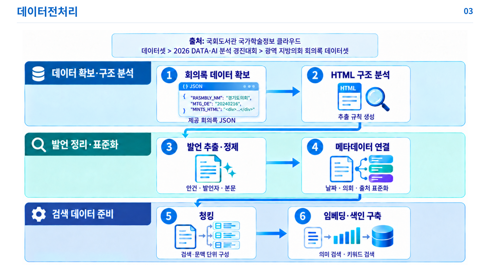

- **핵심 메시지**: 이기종 HTML의 자동 정제, 205만 행 Canonical 표준 데이터셋 구축
- **구어체 스크립트**:
> "데이터 전처리 과정입니다.
> 
> 대회 제공 회의록은 지자체마다 HTML 태그 구조가 다르고 단순 의전 멘트가 섞여 있었습니다. 저희는 로컬 LLM을 활용해 의회별 셀렉터 규칙을 자동 추론하여 안건명, 발언자, 발언 본문만을 정확히 추출했습니다.
> 
> 그 결과 **총 2,057,214행에 달하는 Canonical 표준 데이터셋**을 구축했습니다. 모든 발언에는 고유 식별자인 `chunk_id`와 본문 해시를 부여하여, 이후 임베딩, DB 검색, 시각화 웹 화면이 언제나 단일 원본을 오차 없이 참조하도록 데이터 무결성을 확립했습니다."

---

### [Slide 05] 부모 · 자식 청킹 구조와 검색 흐름 (02:30 ~ 03:20 / 50초)

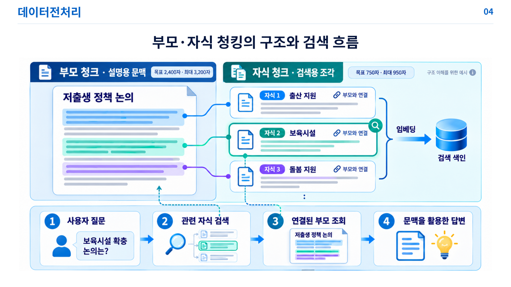

- **핵심 메시지**: 작은 자식(750자)으로 정밀 검색, 큰 부모(2,400자)로 풍부한 문맥 복원
- **구어체 스크립트**:
> "검색 품질을 결정짓는 **부모-자식 청킹(Parent-Child Chunking)** 구조입니다.
> 
> 청크가 너무 길면 여러 주제가 뒤섞여 검색 정확도가 떨어지고, 반대로 너무 짧으면 발언의 전후 맥락이 사라지는 딜레마가 있습니다.
> 
> 저희는 상단처럼 2,400자 크기의 **설명용 '부모 청크'**를 먼저 구성하고, 그 안에서 750자 내외의 **검색용 '자식 청크'** 90만 개를 파생시켰습니다.
> 
> 하단 흐름을 보시면, 사용자가 '보육시설 확충 논의는?' 하고 질문했을 때 시스템은 **자식 청크 색인에서 날카롭게 타겟 발언을 검색**한 뒤, 메타데이터의 `parent_chunk_id`를 통해 **2,400자 부모 청크를 즉시 복원**합니다. 검색의 높은 정밀도와 문맥의 풍부함을 동시에 확보한 전략입니다."

---

### [Slide 06] 임베딩 및 벡터 DB 실측·선정 (03:20 ~ 04:20 / 60초)

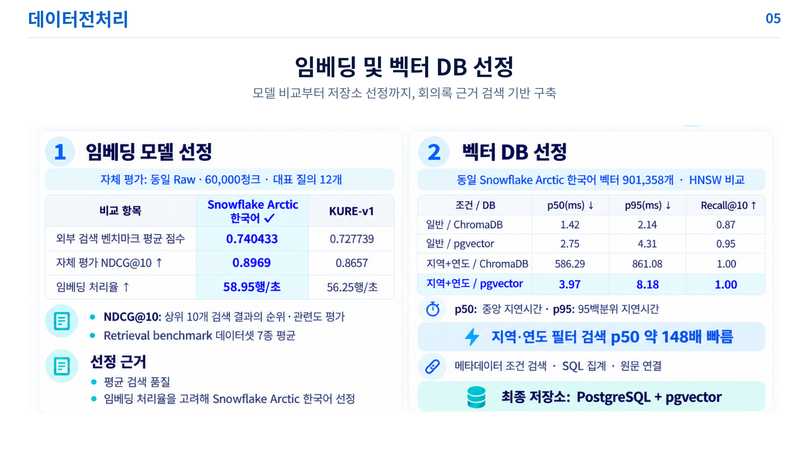

- **핵심 메시지**: 자체 실측 벤치마크 기반 선정 (Arctic nDCG@10 0.8969 / pgvector 복합필터 시 148배 가속)
- **구어체 스크립트**:
> "저희는 철저한 **실측 벤치마크**를 통해 핵심 엔진을 선정했습니다.
> 
> 좌측 임베딩 모델 평가를 보시겠습니다. 6만 청크와 12개 대표 질의로 블라인드 평가를 진행한 결과, 행정 도메인이 잘 반영된 **Snowflake Arctic 한국어 모델**이 자체 평가 nDCG@10에서 **0.8969**, 처리율 초당 58.95행을 기록하며 KURE-v1을 앞서 최종 선정되었습니다.
> 
> 우측의 벡터 DB 선정은 본 프로젝트의 핵심 엔지니어링 성과입니다. 90만 개 벡터를 적재하고 실측한 결과, 단순 검색에서는 양측 모두 1~2ms대로 빨랐지만, 의정 분석의 필수 조건인 **'지역+연도' 복합 필터 검색**에서 ChromaDB는 p50 586.29ms로 지연된 반면, **pgvector는 3.97ms로 무려 148배 빠른 속도**를 입증했습니다.
> 
> SQL 조인의 유연성과 엔터프라이즈 안정성을 고려해 최종 저장소로 **PostgreSQL + pgvector**를 확정했습니다."

---

### [Slide 07] 정책 이슈 검색 및 흐름 분석 (04:20 ~ 05:10 / 50초)

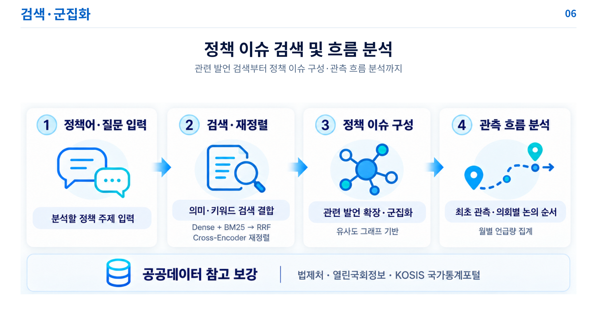

- **핵심 메시지**: 하이브리드 검색(Dense+BM25 RRF), BGE 재순위, Union-Find 그래프 군집화
- **구어체 스크립트**:
> "정책 이슈 검색 및 군집화 파이프라인입니다.
> 
> 질문이 입력되면, 의미를 찾는 Dense 벡터 검색과 정확한 조례명을 찾는 BM25 키워드 검색을 **RRF(Reciprocal Rank Fusion)**로 안정적으로 결합하고, 상위 후보들을 **BGE Reranker Cross-Encoder**로 정밀 재정렬합니다.
> 
> 이어서 상위 10개 발언을 seed로 삼아 중심 벡터를 만들고 90만 풀에서 연관 후보들을 확장한 뒤, 발언 간 유사도 그래프를 구축하고 **Union-Find 알고리즘**을 적용해 단일 정책 이슈 클러스터를 완성합니다.
> 
> 군집된 발언의 일자를 추적하여 **'최초 관측 시점'**과 지자체별 논의 순서를 정렬하며, 법제처 조례와 국회 의안 정보를 참고자료로 연계하여 분석을 보강합니다."

---

### [Slide 08] 정책 논의 정량 예측 (05:10 ~ 06:05 / 55초)

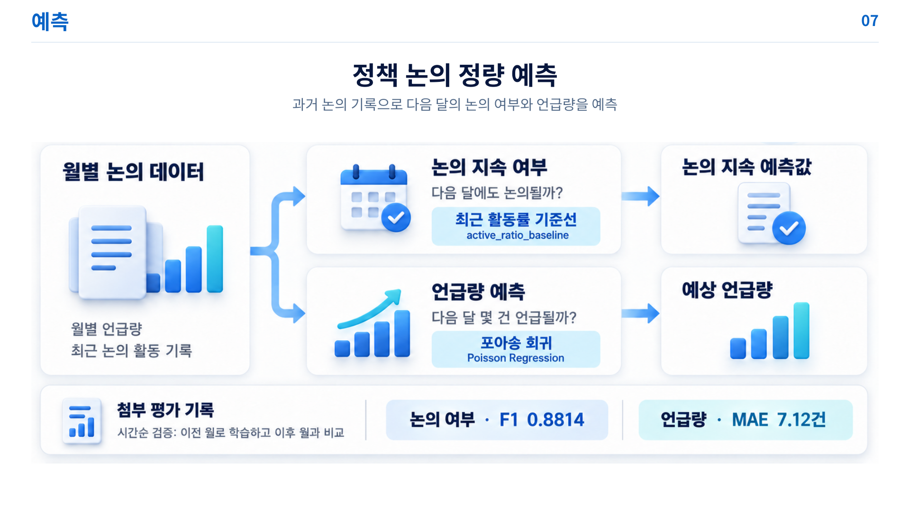

- **핵심 메시지**: 시간 누출 없는 Rolling Backtest 검증, 논의 지속 F1 0.8814, 언급량 MAE 7.12건
- **구어체 스크립트**:
> "정책 논의 정량 예측 단계입니다.
> 
> 저희는 과거 회의록의 규모, 추세, 기울기, 확산성 등 다차원 시계열 피처를 기반으로 두 가지를 예측합니다.  
> 첫째 다음 달에도 논의가 지속될 것인가, 둘째 몇 건이나 언급될 것인가입니다.
> 
> 시계열 분석에서 미래 정보 누출(Data Leakage)을 원천 차단하기 위해, 무작위 분할 대신 오직 과거 월만 학습하고 다음 월을 검증하는 **시간순 Rolling Backtest (10 Folds)**를 엄격히 적용했습니다.
> 
> 실측 결과, **논의 지속 여부는 활동률 기준선 모델이 F1 Score 0.8814**를 기록했고, **언급량 예측은 포아송 회귀(Poisson Regression) 모델이 MAE 7.12건, RMSE 10.04건**을 달성했습니다. 직전 달 유지 기준선 대비 **오차를 29.8% 대폭 개선**했으며 방향성 정확도는 76%에 달했습니다."

---

### [Slide 09] 로컬 LLM 기반 전망 설명 및 AI 에이전트 (06:05 ~ 06:50 / 45초)

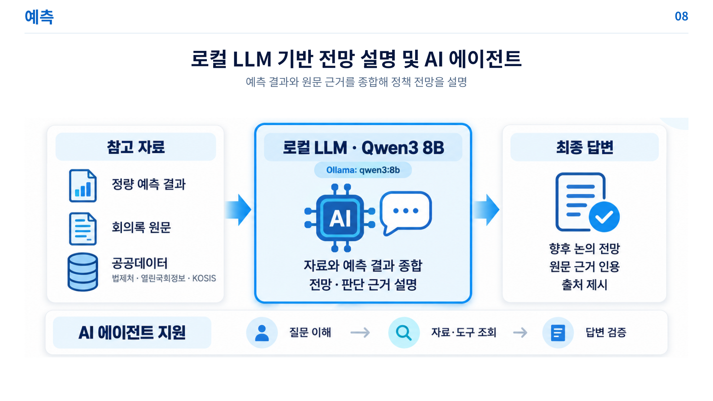

- **핵심 메시지**: 100% 로컬 구동(Ollama Qwen3:8B), 정량 수치와 원문 근거 기반 브리핑
- **구어체 스크립트**:
> "예측 결과와 회의록 원문을 종합 설명하는 **로컬 AI 에이전트**입니다.
> 
> 공공 데이터 보안을 위해 외부 API가 아닌 **로컬 Ollama의 Qwen3:8B 모델**을 사용했습니다.
> 
> 화면 중앙을 보시면, 포아송 회귀가 계산한 정량 예측값과 회의록 원문 근거가 정형 프롬프트로 주입됩니다. 로컬 LLM은 이를 종합하여 '다음 달 논의 증가 전망'과 '핵심 발언 근거'를 읽기 쉬운 정책 리포트로 풀어냅니다.
> 
> 하단의 에이전트 파이프라인을 통해 질문 의도 분석, DB 자료 조회, 그리고 생성된 답변의 회의록명과 일자가 실제 DB와 일치하는지 자체 검증을 거쳐 최종 사용자에게 전달됩니다."

---

### [Slide 10] 핵심 코드 ① 하이브리드 검색 (06:50 ~ 07:25 / 35초)

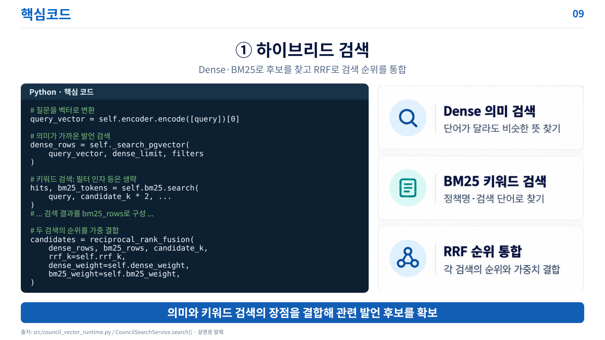

- **핵심 메시지**: `src/council_vector_runtime.py` Dense + BM25 RRF 순위 융합 로직
- **구어체 스크립트**:
> "핵심 구현 코드입니다. 첫째는 하이브리드 검색 서비스 로직입니다.
> 
> 좌측 코드를 보시면 질문을 벡터로 변환하여 pgvector에서 Dense 후보를 찾고, 동시에 SQLite FTS5에서 BM25 키워드 후보를 추출합니다.  
> 그리고 하단의 `reciprocal_rank_fusion` 함수를 통해 두 검색 순위를 결합합니다.  
> 점수 척도가 다른 의미 검색과 키워드 검색의 편향을 없애고, 문맥 유사 발언과 고유명사 조례 발언 모두를 상위권에 놓치지 않고 포섭하는 핵심 코드입니다."

---

### [Slide 11] 핵심 코드 ② 코사인 유사도 기반 이슈 군집 (07:25 ~ 08:00 / 35초)

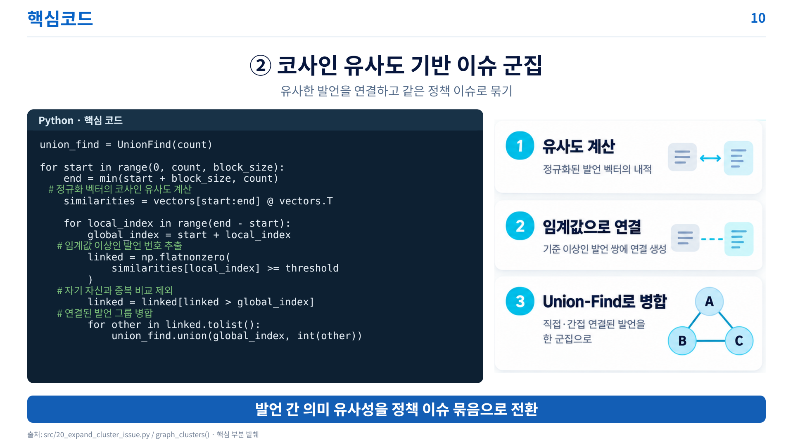

- **핵심 메시지**: `src/20_expand_cluster_issue.py` 블록 행렬 연산 및 Union-Find 고속 병합
- **구어체 스크립트**:
> "두 번째는 유사도 그래프 기반 이슈 군집화 코드입니다.
> 
> 대규모 후보 벡터들의 유사도를 계산할 때 메모리를 아끼기 위해 블록 단위 행렬 곱(`@ vectors.T`)을 수행합니다.  
> 최적 실측 임계값 0.68 이상인 발언 쌍에 대해서만 간선을 연결하고, 우측 다이어그램처럼 서로 연관된 발언들을 **Union-Find 자료구조**로 거의 선형 시간에 초고속 병합합니다.  
> 흩어져 있던 수백 개의 개별 발언이 단일 정책 이슈로 응집되는 과정입니다."

---

### [Slide 12] 핵심 코드 ③ 외부 공공데이터 API 호출 (08:00 ~ 08:25 / 25초)

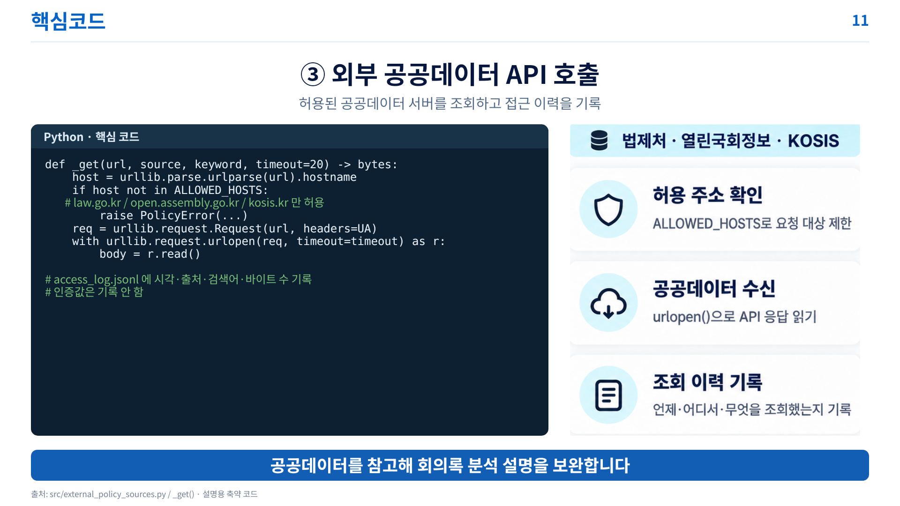

- **핵심 메시지**: `src/external_policy_sources.py` 도메인 화이트리스트 및 감사 로그
- **구어체 스크립트**:
> "세 번째는 외부 공공데이터 보안 연동 모듈입니다.
> 
> `ALLOWED_HOSTS` 화이트리스트를 두어 법제처, 국회, 통계청 3개 공공 도메인 외의 모든 요청을 원천 차단합니다.  
> 또한 호출 시각, 출처, 검색어, 응답 크기를 `access_log.jsonl`에 투명하게 기록하여 철저한 감사 추적성을 확보했습니다."

---

### [Slide 13] 시각화 - 정책 분석 결과를 한눈에 (08:25 ~ 09:10 / 45초)

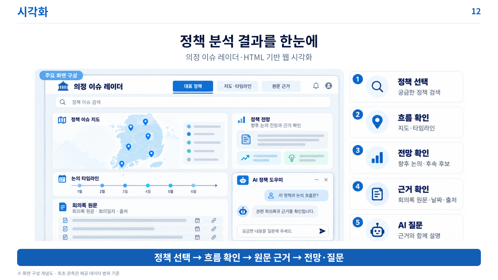

- **핵심 메시지**: 전국 지도 타임라인, 원문 근거 뷰어, AI 챗봇이 결합된 원스톱 대시보드
- **구어체 스크립트**:
> "최종 사용자를 위한 인터랙티브 웹 대시보드 화면입니다.
> 
> 사용자는 5단계 흐름을 따라 직관적으로 분석 결과를 탐색할 수 있습니다.  
> 관심 정책을 검색하거나 TOP 10 탭을 클릭하면, 좌측 지도와 타임라인에 **선도 지자체와 후속 논의 흐름**이 펼쳐집니다.  
> 우측 상단에서 **다음 달 논의 지속 확률과 예상 언급량**을 확인하고, 좌측 하단에서는 그 판단 근거가 된 **실제 회의록 원문과 발언자**를 직접 대조할 수 있습니다.  
> 궁금한 점은 우측 하단의 AI 정책 도우미 챗봇에게 질문하여 즉각적인 근거 중심 답변을 얻을 수 있습니다."

---

### [Slide 14] 맺음말 및 질의응답 (09:10 ~ 09:25 / 15초)

- **핵심 메시지**: 프로젝트 의의 간결한 정리 및 Q&A 개시
- **구어체 스크립트**:
> "의정 이슈 레이더는 205만 회의록을 부모·자식 청킹과 pgvector로 고속 색인하고, 하이브리드 검색과 Union-Find 군집화로 정책 흐름을 규명하며, Rolling Backtest 통계 모델과 로컬 LLM으로 신뢰할 수 있는 미래 예측을 구현했습니다.
> 
> 경청해 주셔서 대단히 감사합니다. 질문 주시면 성심껏 답변드리겠습니다."

---

# 🎯 심사위원 핵심 예상 질의 및 완벽 방어 답변 (Q&A Defense Guide)

발표 종료 후 질의응답 시간에 대비한 핵심 문답입니다.

---

### Q1. 부모 청크를 직접 임베딩하지 않고, 왜 부모-자식(Parent-Child) 2계층 구조를 썼나요?
> **답변 핵심**:  
> "2,400자에 달하는 큰 부모 청크를 통째로 임베딩하면 여러 세부 논점이 한 벡터에 섞여 유사도 초점이 흐려지는 '의미 희석(Semantic Dilution)'이 일어납니다. 반대로 700자 이하 작은 청크만 쓰면 단어는 잘 찾지만 발언자의 전후 맥락이 끊깁니다.  
> 따라서 **'750자 자식 벡터로 검색 정확도를 극대화하고, 연결된 2,400자 부모 본문으로 문맥 완결성을 확보'**하기 위해 2계층 구조를 설계했습니다."

---

### Q2. LLM 메타데이터를 추가한 Enriched 대신 왜 Raw 본문 표현을 최종 임베딩으로 채택했나요?
> **답변 핵심**:  
> "6만 개 표본에 대한 nDCG@10 블라인드 테스트 결과, **Raw가 0.8928, Enriched가 0.8871**로 Raw가 근소하게 우세했습니다.  
> LLM 요약문에 '지원 방안 논의', '정책 추진 촉구' 등 공통 행정 상투어가 들어가면서 서로 다른 문서 간 벡터 거리가 좁혀져 변별력이 저하되었기 때문입니다.  
> 따라서 **벡터 색인에는 순수 원문(Raw)을 유지**하고, 고품질 메타데이터는 **'검색 필터링'과 '시계열 집계 피처'**로 분리 활용했습니다."

---

### Q3. ChromaDB 대신 PostgreSQL + pgvector를 최종 선정한 결정적 이유는 무엇인가요?
> **답변 핵심**:  
> "단순 벡터 검색은 두 DB 모두 빨랐지만, 의정 분석의 필수 조건인 **'지역+연도' 복합 메타 필터 검색**에서 ChromaDB는 p50 586.29ms로 느려진 반면, **pgvector는 3.97ms로 무려 148배 빠른 속도**를 보였습니다.  
> 또한 205만 행의 원문 테이블 및 시계열 집계 테이블과 원활한 SQL 관계형 조인이 가능하다는 엔터프라이즈 운영 측면에서도 pgvector가 압도적이었습니다."

---

### Q4. 시계열 예측 검증 시 일반 K-Fold가 아닌 Rolling Backtest를 적용한 이유는 무엇인가요?
> **답변 핵심**:  
> "일반 K-Fold는 데이터를 무작위 셔플하므로 8월 데이터로 학습해 3월을 예측하는 식의 **'미래 정보 누출(Look-ahead bias / Data Leakage)'**이 발생합니다.  
> 이를 차단하기 위해 실제 서비스와 동일하게 오직 과거 월만 학습하고 다음 1개월을 검증하는 **10-Fold Rolling Backtest**를 적용하여 F1 0.8814, MAE 7.12건이라는 정직하고 실전적인 성능을 입증했습니다."

---

### Q5. 예측 수치 계산을 왜 LLM에 직접 시키지 않고 전통 통계 모델(포아송 회귀 등)로 분리했나요?
> **답변 핵심**:  
> "LLM에게 숫자 예측을 시키면 확률 분포에 기반하지 않은 환각(Hallucination)이 발생하고 매번 수치가 바뀌어 재현성이 없습니다.  
> 따라서 **'정량 수치 계산은 수학적 통계 모델에 일임하고, LLM은 계산 결과와 회의록 원문을 읽기 쉽게 브리핑하는 역할'**로 엄격히 분리하여 신뢰성을 극대화했습니다."
