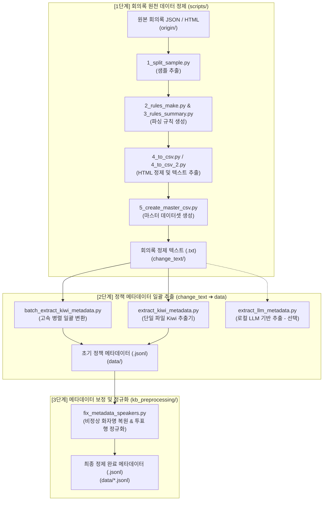

# 🔄 지방의회 회의록 전처리 및 JSONL 메타데이터 변환 파이프라인

본 브랜치(`feature/data-preprocessing`)는 광역의회 회의록 원천 데이터(JSON/HTML)를 정제하고, 한국어 형태소 분석기(Kiwi) 및 로컬 LLM을 활용하여 구조화된 정책 메타데이터(JSONL)로 일괄 변환하는 **데이터 전처리 파이프라인 전용 브랜치**입니다.

- **텍스트 정제 파이프라인**: [`scripts/`](file:///c:/study/Projects/team-ggeodeureok/scripts)
- **JSONL 메타데이터 변환 및 보정 파이프라인**: [`kb_preprocessing/`](file:///c:/study/Projects/team-ggeodeureok/kb_preprocessing)

---

## 🌊 전체 파이프라인 흐름도



---

## 📁 디렉토리 및 파일 구조

```plaintext
team-ggeodeureok/
├── scripts/                            # [1단계] 원본 HTML 파싱 및 텍스트 정제 스크립트 모음
│   ├── _constant.py                    # 경로, 연도, 로컬 Ollama 모델 설정
│   ├── 1_split_sample.py               # 회의록 JSON에서 HTML 샘플 추출
│   ├── 2_rules_make.py                 # LLM을 활용한 지자체별 HTML 파싱 규칙 생성
│   ├── 3_rules_summary.py              # 파싱 규칙 요약 및 통합
│   ├── 4_to_csv.py / 4_to_csv_2.py     # 파싱 규칙 기반 HTML 태그 제거 및 텍스트 변환
│   └── 5_create_master_csv.py          # 지자체별 정제 파일 통합
│
├── kb_preprocessing/                   # [2~3단계] change_text ➔ jsonl 변환 및 메타데이터 보정
│   ├── batch_extract_kiwi_metadata.py  # [주력] change_text 폴더 전체를 data/*.jsonl로 일괄 고속 변환
│   ├── extract_kiwi_metadata.py        # Kiwi 형태소 분석기 기반 정책 카테고리/키워드/요약 추출 엔진
│   ├── extract_llm_metadata.py         # [대안] Ollama 로컬 LLM 기반 정책 메타데이터 추출기
│   └── fix_metadata_speakers.py        # data/*.jsonl 화자 오염 복원 및 전자투표 명단 정규화
│
├── requirements.txt                    # 전처리 파이프라인 필수 의존성 패키지
├── .gitignore                          # 대용량 회의록 원천 데이터 및 결과물 형상관리 제외 설정
└── README.md                           # 파이프라인 안내 문서
```

---

## ⚙️ 환경 설정 및 패키지 설치

Python 3.10+ 환경에서 필요한 패키지를 설치합니다:

```bash
pip install -r requirements.txt
```

> **필수 라이브러리**:
> - `kiwipiepy`: C++ 기반 초고속 한국어 형태소 분석 엔진
> - `tqdm`: 진행률 및 경과 시간 표시
> - `beautifulsoup4`: HTML 회의록 태그 파싱
> - `openai`, `requests`: 로컬 Ollama LLM 통신

---

## 🚀 단계별 실행 가이드

> **참고**: 모든 명령어는 프로젝트 루트(`team-ggeodeureok/`)에서 실행하는 것을 기본으로 합니다.

### 1단계: 원시 데이터(HTML/JSON) ➔ 정제 텍스트(`change_text/`)
`scripts/` 내의 파이프라인을 순차적으로 실행하여 원본 회의록 HTML 태그를 정제하고 텍스트(`change_text/*.txt`)를 추출합니다.

```bash
# 1. 설정 확인 (scripts/_constant.py 내 대상 연도 및 경로 확인)
# 2. 샘플 추출 및 규칙 생성
python scripts/1_split_sample.py
python scripts/2_rules_make.py
python scripts/3_rules_summary.py

# 3. 텍스트/CSV 변환
python scripts/4_to_csv_2.py
python scripts/5_create_master_csv.py
```

### 2단계: 정제 텍스트(`change_text/`) ➔ 정책 메타데이터(`data/*.jsonl`)
정제된 회의록 텍스트(.txt)를 읽어 실질 정책 발언 선별, 7대 정책 분야 분류, 2어절 복합 키워드, 추출 요약을 생성합니다.

#### ⚡ Kiwi 형태소 분석기 일괄 변환 (권장, 초고속)
```bash
# change_text/ 내의 모든 34개 지자체 회의록 일괄 변환
python kb_preprocessing/batch_extract_kiwi_metadata.py --input-dir change_text --output-dir data

# 연도별 선택 변환 (예: 2024년도만)
python kb_preprocessing/batch_extract_kiwi_metadata.py --input-dir change_text --output-dir data --year 2024 --workers 4

# 단일 파일 변환 테스트
python kb_preprocessing/extract_kiwi_metadata.py --input change_text/2024_광역의회/cleaned_2024_강원특별자치도의회.txt --output data/2024_광역의회/cleaned_2024_강원특별자치도의회.jsonl
```

#### 🤖 로컬 LLM 기반 추출 (선택 사항)
```bash
python kb_preprocessing/extract_llm_metadata.py --input change_text/2024_광역의회/cleaned_2024_강원특별자치도의회.txt --output data/llm_output.jsonl
```

### 3단계: 화자명 및 전자투표 결과 메타데이터 보정
일부 회의록에서 조례명이 화자명으로 잘못 유입되었거나, 단순 의원 명단 나열(전자투표)이 정책 발언으로 분류된 행을 원문 대조를 통해 자동 보정합니다.

```bash
# 보정 대상 사전 점검 (Dry-run)
python kb_preprocessing/fix_metadata_speakers.py --dry-run

# 실제 일괄 보정 적용
python kb_preprocessing/fix_metadata_speakers.py
```

---

## 📋 최종 산출물 규격 (`JSONL`)

각 라인은 아래 스키마를 만족하는 독립된 JSON 객체로 구성됩니다:

```json
{
  "row_id": 1042,
  "date": "2024-03-15",
  "assembly": "강원특별자치도의회",
  "speaker": "김진태",
  "agenda": "2024년도 제1회 추가경정예산안 심사",
  "is_substantive": true,
  "policy_category": "경제/산업",
  "core_issue": "반도체 클러스터 유치 및 테스트베드 국비 확보 방안",
  "keywords": ["반도체 클러스터", "국비 확보", "테스트베드 구축"],
  "summary": "반도체 교육원 설립과 테스트베드 구축을 통해 기업 유치를 가속화하겠다고 밝힘."
}
```
