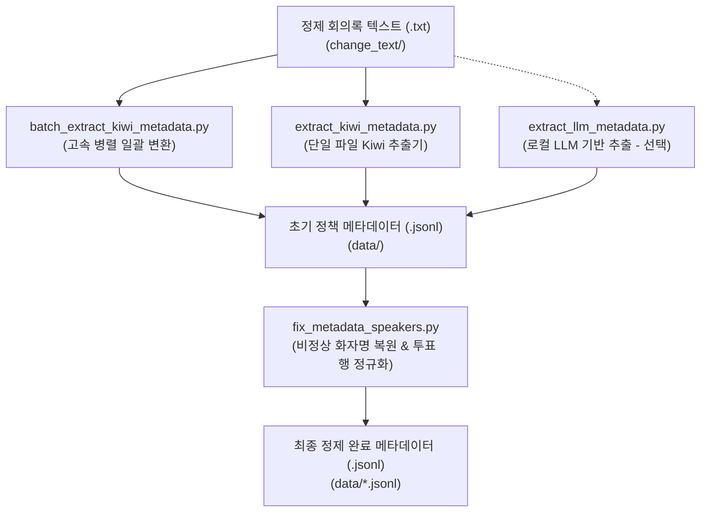

# 🏛️ 회의록 메타데이터 변환 및 전처리 모듈 (`kb_preprocessing`)

본 디렉토리(`kb_preprocessing/`)는 1차 정제된 광역의회 회의록 텍스트(`../change_text/*.txt`)를 기반으로, 한국어 형태소 분석기(Kiwi) 및 로컬 LLM을 활용하여 구조화된 정책 메타데이터(`../data/*.jsonl`)로 일괄 변환하고 화자/표결 데이터를 정규화하는 **메타데이터 파이프라인 모듈**입니다.

> 💡 **참고**: 원천 데이터(JSON/HTML)에서 `change_text/*.txt`를 생성하는 1차 텍스트 정제 작업은 상위 디렉토리의 [`../scripts/`](file:///c:/study/Projects/team-ggeodeureok/scripts)에서 사전 수행됩니다.

---

## 📁 모듈 디렉토리 및 파일 구조

```plaintext
kb_preprocessing/
├── batch_extract_kiwi_metadata.py  # [주력] change_text 전체를 data/*.jsonl로 일괄 고속 변환 (Multi-worker)
├── extract_kiwi_metadata.py        # Kiwi 형태소 분석기 기반 정책 카테고리/키워드/요약 추출 엔진
├── extract_llm_metadata.py         # [대안] Ollama 로컬 LLM 기반 정책 메타데이터 추출기
├── fix_metadata_speakers.py        # data/*.jsonl 화자 오염 복원 및 전자투표 명단 정규화
└── README.md                       # 본 모듈 가이드 문서
```

---

## 🌊 파이프라인 흐름도



---

## ⚙️ 사전 환경 준비

상위 프로젝트 루트에 위치한 `requirements.txt` 패키지를 설치합니다:

```bash
pip install -r ../requirements.txt
```

> **핵심 의존성**:
> - `kiwipiepy`: C++ 기반 초고속 한국어 형태소 분석 엔진 (LLM 대비 100배 고속)
> - `tqdm`: 파일 및 행 단위 실시간 진행률 표시
> - `openai`, `requests`: 로컬 Ollama LLM 통신 (LLM 모드 사용 시)

---

## 🚀 실행 가이드 (디렉토리 내부 기준: `cd kb_preprocessing`)

`kb_preprocessing` 디렉토리 내부로 이동한 후 아래 명령어를 실행합니다:

```bash
cd kb_preprocessing
```

### 1. Kiwi 형태소 분석기 일괄 변환 (권장, 초고속)
`../change_text/` 폴더 내의 모든 광역의회 회의록(.txt)을 재귀 탐색하여 `../data/`에 `.jsonl` 파일로 일괄 변환합니다.

```bash
# 전체 지자체 회의록 일괄 변환 (기본 4개 스레드 병렬 가속)
python batch_extract_kiwi_metadata.py --input-dir ../change_text --output-dir ../data

# 연도별 선택 변환 (예: 2024년도 회의록만)
python batch_extract_kiwi_metadata.py --input-dir ../change_text --output-dir ../data --year 2024 --workers 4

# 파일당 최대 100건만 샘플 추출 테스트
python batch_extract_kiwi_metadata.py --input-dir ../change_text --output-dir ../data --sample-per-file 100
```

### 2. 단일 파일 단위 Kiwi 메타데이터 추출 테스트
특정 지자체 회의록 파일 1개만 지정하여 변환할 때 사용합니다:

```bash
python extract_kiwi_metadata.py --input ../change_text/2024_광역의회/cleaned_2024_강원특별자치도의회.txt --output ../data/2024_광역의회/cleaned_2024_강원특별자치도의회.jsonl
```

### 3. 로컬 LLM 기반 메타데이터 추출 (선택 사항)
Ollama에 `exaone3.5:7.8b` 등의 모델이 준비되어 있는 경우 로컬 LLM을 통한 정밀 추출을 수행할 수 있습니다:

```bash
python extract_llm_metadata.py --input ../change_text/2024_광역의회/cleaned_2024_강원특별자치도의회.txt --output ../data/llm_output.jsonl
```

### 4. 화자명 및 전자투표 결과 메타데이터 일괄 보정
일부 회의록에서 조례안/안건명이 화자명으로 잘못 유입되었거나, 단순 의원 명단 나열(전자투표 찬/반)이 정책 발언으로 분류된 행을 원문(`../change_text/`) 대조를 통해 자동 보정합니다:

```bash
# 1) 보정 대상 사전 점검 (Dry-run: 실제 파일은 수정하지 않고 로그만 출력)
python fix_metadata_speakers.py --dry-run

# 2) 실제 일괄 보정 적용
python fix_metadata_speakers.py
```
> ※ `fix_metadata_speakers.py`는 내부적으로 상위 프로젝트 루트의 `../data` 및 `../change_text`를 자동 탐색하도록 설계되어 있어 별도 인자 없이 즉시 실행 가능합니다.

---

## 💡 상위 프로젝트 루트에서 실행 시 명령어 요약

프로젝트 루트(`team-ggeodeureok/`) 위치에서 실행할 경우 아래와 같이 호출할 수 있습니다:

```bash
# 루트 위치 기준
python kb_preprocessing/batch_extract_kiwi_metadata.py --input-dir change_text --output-dir data
python kb_preprocessing/fix_metadata_speakers.py
```

---

## 📋 최종 산출물 규격 (`JSONL`)

각 행은 독립된 JSON 객체이며 아래 규격으로 저장됩니다:

```json
{
  "row_id": 1042,
  "date": "2024-03-15",
  "assembly": "강원특별자치도의회",
  "speaker": "김진태",
  "agenda": "2024년도 제1회 추가경정예산안 심사",
  "is_substantive": true,
  "policy_category": "경제/산업",
  "core_issue": "반도체 클러스터 유치 및 테스트베드 국비 확보 방안",
  "keywords": ["반도체 클러스터", "국비 확보", "테스트베드 구축"],
  "summary": "반도체 교육원 설립과 테스트베드 구축을 통해 기업 유치를 가속화하겠다고 밝힘."
}
```

* `is_substantive`: 실질 정책 논의 여부 (`false`는 단순 의전, 개의/폐회 선포, 단순 표결 나열)
* `policy_category`: 7대 정책 분야 (`경제/산업`, `농림/수산`, `보건/복지`, `교육/문화`, `환경/안전`, `도시/교통`, `자치/행정`)
* `keywords`: 2~4어절의 핵심 정책 복합명사구 목록
